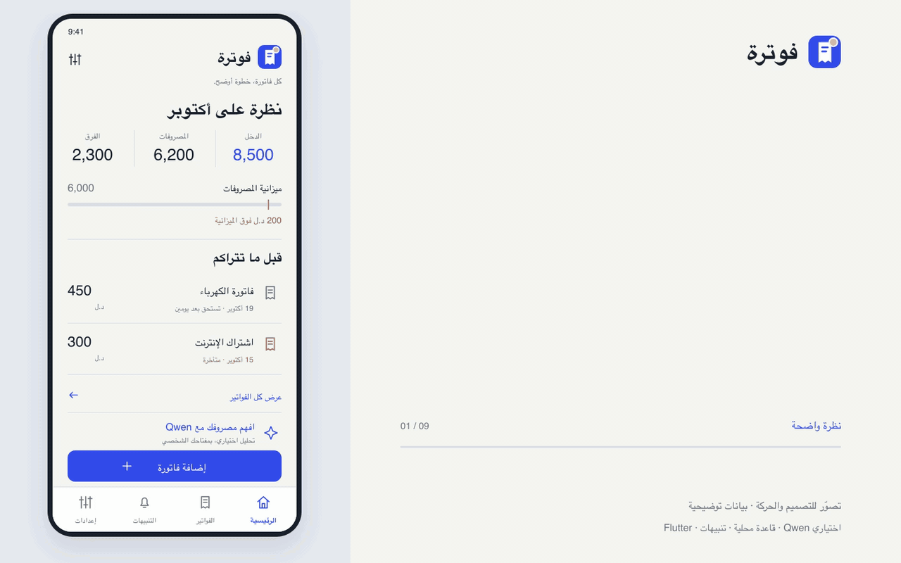

# فوترة · Fawtara

A mobile-first Arabic invoice image archive. This public edition runs entirely in the browser, with no database, backend service, account or API key to configure.

نسخة عامة لحفظ صور الفواتير وتنظيمها والبحث فيها. الفواتير محفوظة على المتصفح نفسه فقط، من غير قاعدة بيانات أو ربط تخزين خارجي.

<p align="center">


</p>

## Features

- Capture an invoice photo or select an image from the device.
- Compress images locally and add a client name, date and notes.
- Browse, search, filter by date, edit and delete invoice records.
- Search Arabic client names and notes despite diacritics, tatweel, alef variants or repeated spaces; original invoice text is preserved.
- Keep the archive in the current browser's local storage between visits.
- Start with an empty archive; no customer records or credentials are included.

## Planned mobile edition · design preview

<p align="center"></p>

**كل فاتورة، خطوة أوضح.**



[Full design screen](docs/mobile-concept.png) · [43-second video](docs/mobile-walkthrough.mp4)

The owner has requested a Flutter mobile edition with a local SQLite database, money amounts, due dates, financial alerts and optional Qwen analysis using each user's own API key.

**Status:** these files are a UI and motion proposal with illustrative data. The current runnable source in this repository is still the browser edition documented above. The preview does not demonstrate an implemented Flutter app, notification delivery or a live Qwen response. Images of invoices and customer identities are not sent in this proposal's Qwen flow; a user would review a numerical summary before sending it.

The logo and UI graphics are original presentation assets. Typography: IBM Plex Sans Arabic, SIL OFL 1.1; see [font license](docs/FONT-LICENSE.txt).

## Run the browser edition locally

Requires Node.js 22.18 or newer.

```sh
npm ci
npm run dev
```

```sh
npm test
npm run build
npm run preview
```

The build output is `dist/`. A static host must serve `index.html` for application routes such as `/add`, `/search` and `/invoice/:id`. Use HTTPS for camera support on devices.

## Storage

Images and invoice details are stored in `localStorage` under `fawtara-public-invoices`. They stay in that browser and are not uploaded by this application. Clearing site data removes the archive. Browser storage has a size limit; this edition does not provide cloud backup or synchronization between devices.

The interface downloads the Cairo font from Google Fonts. Image processing runs locally without downloading a compression worker.

## Questions and support

Maintainer-written Arabic FAQs:

- [Where are invoices stored, and do they sync between devices?](https://github.com/mohamedkbay/fawtara-public/discussions/7)
- [Are Flutter, notifications and Qwen implemented yet?](https://github.com/mohamedkbay/fawtara-public/discussions/8)

Use [Q&A](https://github.com/mohamedkbay/fawtara-public/discussions/categories/q-a) for usage questions. When reporting a bug, describe the steps with fictional examples; do not post real invoice images, customer details or API keys.

## Technology

React · TypeScript · Material UI · Zustand · Vite

This repository starts from a reviewed source snapshot with fresh history. It contains no database configuration, remote invoice storage integration, fixed access PIN or operational invoice data. The original private application is maintained separately.

Dependency and template attributions are preserved in [ATTRIBUTIONS.md](ATTRIBUTIONS.md).
